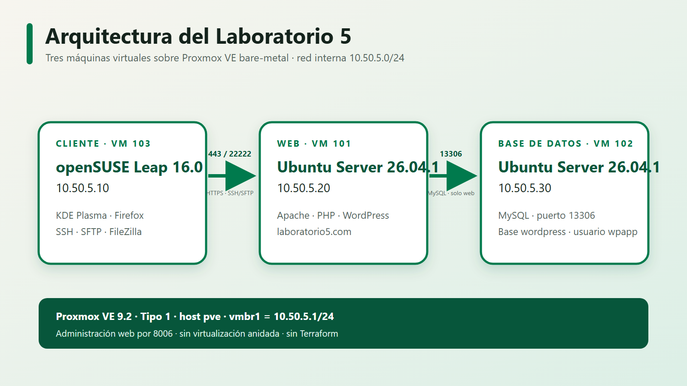
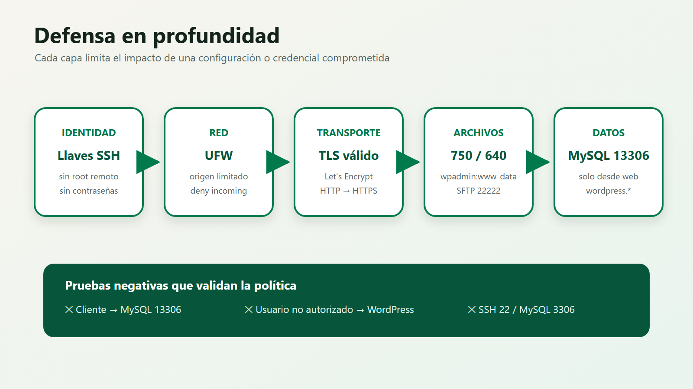

# Laboratorio 5 de Redes · Grupo 2

> Mini datacenter virtualizado con Proxmox VE bare-metal, WordPress y MySQL en dos capas, administración desde openSUSE y HTTPS válido mediante Let's Encrypt.

## Estado del proyecto

**Implementación técnica completada y auditada.** Las tres máquinas virtuales operan simultáneamente, WordPress responde en `https://laboratorio5.com`, MySQL solo es accesible desde la capa web y las auditorías finales de cliente, web y DB terminan con cero fallos.

| Área | Resultado |
|---|---|
| Hipervisor | Proxmox VE 9.2 instalado directamente en hardware físico |
| Cliente | openSUSE Leap 16.0 con KDE Plasma |
| Servidores | Ubuntu Server 26.04.1 LTS sin entorno gráfico |
| Aplicación | WordPress sobre Apache y PHP |
| Base de datos | MySQL independiente en `10.50.5.30:13306` |
| Dominio | `laboratorio5.com`, DNS administrado en Amazon Route 53 |
| TLS | Certificado válido de Let's Encrypt mediante DNS-01 |
| Administración | SSH/SFTP por `22222/TCP` con llaves |
| Seguridad | UFW, permisos POSIX, mínimo privilegio y pruebas negativas |
| Auditorías | Web, DB y cliente: **0 fallos** |

## Arquitectura



| Nodo | Sistema | IP interna | Rol |
|---|---|---:|---|
| `pve` | Proxmox VE 9.2 | `10.50.5.1` | Hipervisor Tipo 1 y puente `vmbr1` |
| `lab5-cliente` | openSUSE Leap 16.0 KDE | `10.50.5.10` | Navegador, SSH, FileZilla y demostración |
| `lab5-web` | Ubuntu Server 26.04.1 LTS | `10.50.5.20` | Apache, PHP, WordPress y cliente MySQL |
| `lab5-db` | Ubuntu Server 26.04.1 LTS | `10.50.5.30` | MySQL y base `wordpress` |

La red interna es `10.50.5.0/24`. El cliente accede a WordPress por HTTPS y administra los servidores por SSH/SFTP. Solamente `lab5-web` puede abrir una sesión MySQL hacia `lab5-db`.

## Puertos y política de acceso

| Destino | Puerto | Origen permitido | Uso |
|---|---:|---|---|
| `lab5-web` | `22222/TCP` | `10.50.5.10` | SSH/SFTP |
| `lab5-web` | `80/TCP` | `10.50.5.10` | Redirección a HTTPS |
| `lab5-web` | `443/TCP` | `10.50.5.10` | WordPress HTTPS |
| `lab5-db` | `22222/TCP` | `10.50.5.10` | Administración SSH |
| `lab5-db` | `13306/TCP` | `10.50.5.20` | MySQL desde WordPress |

Los puertos predeterminados `22`, `3306` y `33060` permanecen cerrados. UFW aplica `deny incoming` y las reglas se restringen por dirección de origen.

## Defensa en profundidad



- **Identidad:** autenticación SSH mediante llaves; `root` remoto y contraseñas deshabilitados.
- **Red:** UFW permite únicamente los flujos requeridos.
- **Transporte:** HTTP redirige a HTTPS; el certificado pertenece a `laboratorio5.com`.
- **Archivos:** `wpadmin:www-data`, directorios `750` y archivos `640`.
- **Datos:** `wpapp@10.50.5.20` tiene privilegios únicamente sobre `wordpress.*`.
- **Renovación:** Certbot usa DNS-01 de Route 53 y recarga Apache mediante un hook.

## Organización del repositorio

```text
.
├── bitacora/             Registro de decisiones, problemas y contribuciones
├── configuraciones/      Plantillas sanitizadas de servicios y red
├── docs/                 Runbooks, matriz de evidencia y guía de demostración
├── evidencias/           Capturas reales organizadas por fase
├── informe/              Informe LaTeX, figuras propias y PDF compilado
│   └── figuras/          Diagramas propios; no contiene capturas de infraestructura
├── presentacion/         Presentación HTML 16:9 sin dependencias externas
└── scripts/              Auditorías y utilidades de compilación/validación
```

Las instrucciones originales del laboratorio y el plan operativo se mantienen fuera del repositorio. No se almacenan secretos, llaves privadas, tokens, contraseñas ni el contenido real de `wp-config.php`.

## Evidencias

Las pruebas E01--E17 se clasifican en:

1. `evidencias/01-proxmox/`: hipervisor, puentes y tres VM.
2. `evidencias/02-cliente/`: openSUSE, conectividad, DNS local y administración.
3. `evidencias/03-servidores/`: Ubuntu 26.04.1 y `multi-user.target`.
4. `evidencias/04-wordpress-mysql/`: integración WordPress--MySQL.
5. `evidencias/05-seguridad/`: SSH, SFTP, UFW, permisos y certificado.
6. `evidencias/06-pruebas-finales/`: auditorías y renovación simulada.

`evidencias/99-auxiliares/` conserva material histórico o duplicado que no debe citarse como prueba principal.

## Compilar el informe

Requisitos en Windows:

- MiKTeX con `latexmk` y `pdflatex`.
- PowerShell.

Desde la raíz del repositorio:

```powershell
powershell -ExecutionPolicy Bypass -File .\scripts\compilar-informe.ps1
```

Salida:

```text
informe/output/informe-lab5.pdf
```

## Abrir la presentación HTML

Puede abrirse `presentacion/index.html` directamente. Para servirla localmente:

```powershell
node .\scripts\servir-presentacion.mjs
```

Después visite `http://127.0.0.1:8080`.

Controles principales:

- `→`, espacio o Page Down: avanzar.
- `←` o Page Up: retroceder.
- `F`: pantalla completa.
- `P`: imprimir o exportar a PDF.

## Auditorías

Cada VM utiliza una copia local y revisada de `configuraciones/lab5.env.example` llamada `lab5.env`. Este archivo está ignorado por Git.

```bash
# En lab5-web
bash ~/lab5/scripts/auditar-web.sh

# En lab5-db
bash ~/lab5/scripts/auditar-db.sh

# En lab5-cliente
bash ~/lab5/scripts/auditar-cliente.sh
```

Antes de publicar cambios:

```powershell
powershell -ExecutionPolicy Bypass -File .\scripts\auditar-repositorio.ps1
```

## Demostración recomendada

El procedimiento completo, los comandos, resultados esperados, contingencias y preguntas probables están en [docs/DEMOSTRACION_EN_VIVO_LAB5.md](docs/DEMOSTRACION_EN_VIVO_LAB5.md).

1. Mostrar Proxmox, el host `pve` y las tres VM activas.
2. Desde openSUSE, comprobar conectividad y resolución de `laboratorio5.com`.
3. Entrar por SSH a web y DB usando `22222/TCP`.
4. Mostrar MySQL accesible desde web y bloqueado desde cliente.
5. Mostrar FileZilla SFTP y la prueba de permiso denegado.
6. Abrir WordPress en HTTPS y revisar el certificado de Let's Encrypt.
7. Cerrar con las tres auditorías de cero fallos.

## Restricciones respetadas

- No se utilizó Terraform.
- No se empleó virtualización anidada.
- Proxmox se instaló en la computadora dedicada.
- No se publicaron secretos ni evidencia fabricada.
- Las capturas provienen de la infraestructura real.

## Integrantes

- Pablo Daniel Barillas Moreno — Carné 22193
- Genser Andreé Catalán Espina — Carné 23401
- Andrés Rafael Chivalán Marroquín — Carné 21534
